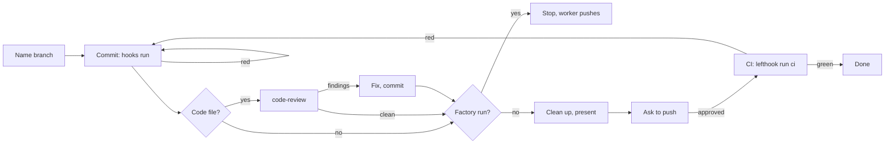

# Done

When a user-invoked task is done, how to show it, and what to clean up.

## Who holds the work

1. Git state says who holds the work:
   - uncommitted = you are still working on it
   - committed on its branch = you consider it done
   - pushed = the user signed it off

## Finish

2. Finish in this order:
   1. Name the branch `<type>/<description>` before the first commit (`workflow-hazards.md` item 4).
   2. Commit the work. The `pre-commit` and `commit-msg` hooks run. Red: fix, commit again.
   3. The commits hold a code file: run [code-review](.agents/skills/code-review/SKILL.md) against the base branch, with the user's request as the spec. Docs, rules or config only: skip the review.
   4. A blocking finding: a fresh subagent fixes it and commits. You do not fix it yourself. No second review.
   5. Small findings in the diff (nits, format, typos, stale docs or tests): fix them yourself in one pass and commit. No new review.
   6. Findings outside the diff: list them as follow-ups. Do not fix them.
   7. In a factory run, stop after the commit. The worker pushes and opens the PR.
   8. In a session with a person: clean up, then present, then ask to push. Stop.

3. Push, PR, and ticket resolution need the user's approval. Ask only when no in-scope work is open.
   - Bad: "Done. Two nits left. Push?"
   - Good: fix the nits, then "Done. Push?"

4. After the push, CI runs `lefthook run ci` and decides. A red CI result comes back to you: fix it on the same branch, commit, push. The first push approval covers these fixes.

5. Never skip the hooks: no `git commit --no-verify`, no `-n`. CI runs the full list anyway.

## Clean up

6. Close the Chrome tabs you opened during the task.

## Present

7. Show the commits, the review findings and the follow-ups. Then ask to push and stop.
