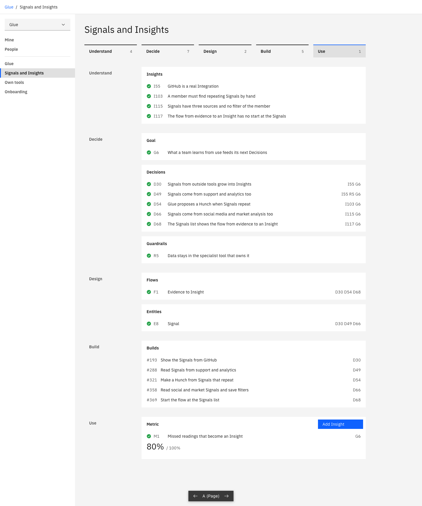
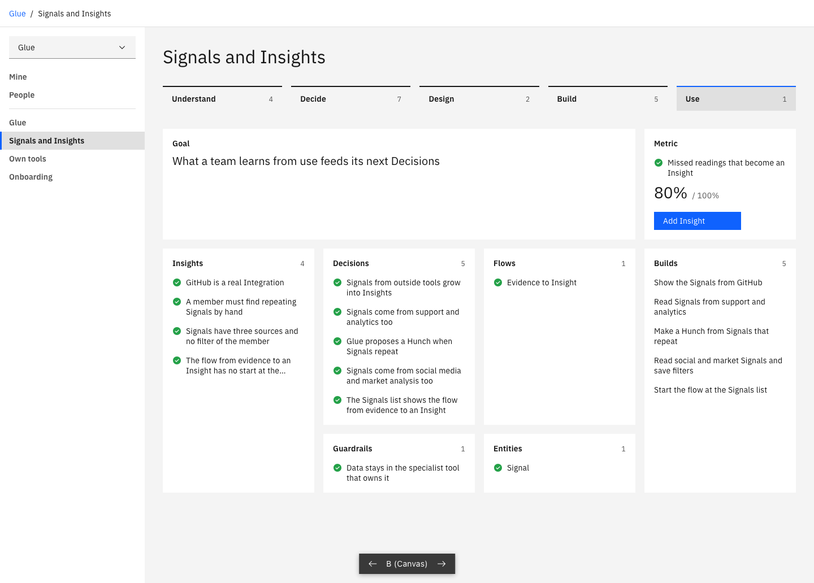
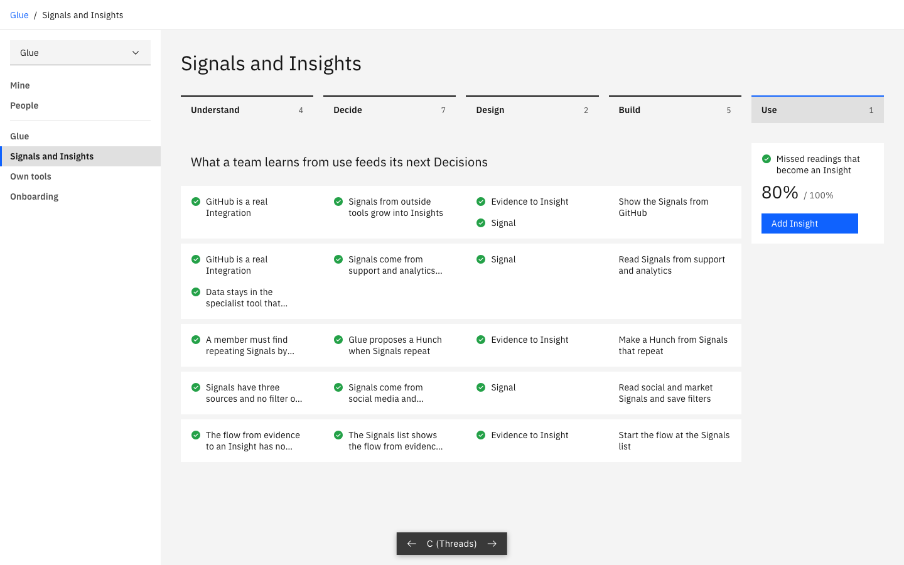

# A Concept as one document

Three variants of the Concept screen for `design-system/D16`. The Concept screen feels like a collection of unrelated things. Each variant shows a Concept as one document with fixed areas ([issue 404](https://github.com/timschoch/glue/issues/404)). This is throwaway code in [src/prototype/concept-document/](../../../src/prototype/concept-document/).

Each variant has three pictures. `full` is a Concept with many Parts, `gaps` is a Concept with missing Parts, and `empty` is a new Concept.

## Run it

```sh
GLUE_PROTOTYPE=1 pnpm exec vite dev --config e2e/vite.config.ts --port 3404
```

- http://localhost:3404/glue/signals-and-insights?variant=A
- http://localhost:3404/glue/signals-and-insights?variant=B
- http://localhost:3404/glue/signals-and-insights?variant=C

The left panel opens the other two Concepts. The bar at the bottom and the arrow keys change the variant. The server uses seed data and no database.

Take the pictures again with `node e2e/prototype-screenshots.mjs`.

## A, Page



- One long document. Each loop step is a chapter, and each area has a fixed place in it.
- It is good for reading. You see each record with its id and the records it needs.
- An empty area is a dashed slot at its place, so you see what is missing.
- It is weak at relations. You must read ids to see what belongs together.
- It is long. A Concept with many Parts needs scrolling.

## B, Canvas



- All areas on one sheet, as boxes at fixed places. The Goal and its Metric are at the top. Below them the areas go from evidence on the left to builds on the right.
- It is good for the overview. You see the whole Concept and its gaps with no scrolling.
- The new Concept already shows the full form, so you see what to fill out.
- It is weak at detail. A box shows five records and no ids.
- The place shows which areas relate. It does not show which record relates to which.

## C, Threads



- Each row is one line of reasoning. It goes from the evidence to the Decision, to the design and to the build. The Goal is above its rows and the Metric is next to them.
- It is good at relations. You see why a Decision exists and what came from it.
- A gap in a row is a missing Part, so the next step is exact. For example, one Decision has no Flow.
- It is weak with records that are in many rows. The same Insight shows again in each row.
- A Part that no Decision needs has no place here.

## What is not real

- The Metric "Missed readings that become an Insight" and its reading are made up. The other records come from the Project `glue`.
- The Concept "Onboarding" is made up, to show a new Concept.
- The buttons do nothing. No variant writes.
- Only the next step has a button. The other empty areas have none, to keep the screen calm.
